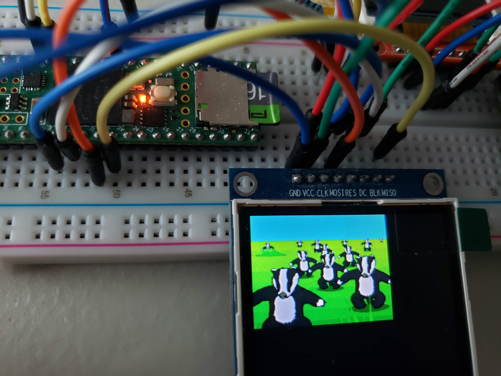
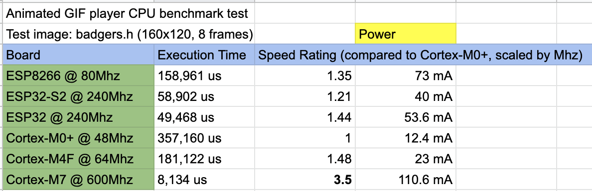

AnimatedGIF-LowMem (Experimental Fork)
======================================

Experimental fork of [bitbank2/AnimatedGIF](https://github.com/bitbank2/AnimatedGIF) (branched from commit [`17a6a2e`](https://github.com/bitbank2/AnimatedGIF/commit/17a6a2eda4385c14f39ee51adfc89ab721150527), tagged `upstream-baseline`) focused on **low-RAM microcontrollers (ESP8266 / LX106)**, **memory-safety hardening**, and **optional cooperative incremental decoding**, while keeping `GIF_PROFILE_FAST` (default) API- and Turbo-compatible with upstream.

Licensed under Apache-2.0 with original BitBank Software, Inc. copyright and attribution retained; see [docs/PROPOSAL.md](docs/PROPOSAL.md) for the full engineering design and empirical results.

## What Changed vs Upstream

- **Memory-safety & parser hardening**: sequential bounds-checked parser (`GIFParseInfo`), hardened `GIF_getInfo()` / `getComment()`, partial-read I/O loop (`GIFReadExact` / `GIFSkipExact`) supporting 1-byte-at-a-time callbacks, 32-bit bit-accumulator `GIFReadCode` without word over-reads or unaligned UB, `nextcode` saturation on full 12-bit dictionaries (deferred Clear Codes), consecutive Clear Code and `Clear Code -> EOI` handling, sub-block draining before next frame, overflow-safe `allocFrameBuf` / `allocTurboBuf`, and `#error` guard against using Turbo mode with compact layouts.
- **Lazy dictionary reset (`GIF_LAZY_RESET=1`, default)**: eliminates Clear Code `memset` overhead by validating codes against `nextcode`.
- **Compact LZW dictionaries (`GIF_DICT_MODE`)**:
  - `0` (default/`FAST`): upstream dual-table dictionary (`usGIFTable` + `ucGIFPixels`, 16384 B).
  - `16` (`BALANCED`/`COOPERATIVE`): 16-bit prefix + 8-bit suffix (12288 B, `-4096 B`), reconstructing first pixels cleanly.
  - `12` (`MINIMAL`): 12-bit packed prefixes (2 entries per 3 bytes) + 8-bit suffix (10240 B, `-6144 B`), preserving **full 12-bit (4096-code) GIF compatibility**.
- **Buffer & palette tuning**: configurable `GIF_FILE_BUF_SIZE` (down to `768 B`, with multi-pass chunked stack fallback `GIFEmitChainChunked` for chains up to `32767` px), `GIF_LZW_BUF_SIZE` (`1530 B` down to `260 B`), and `GIF_RGB565_ONLY=1` (`1024 B` palettes instead of `1536 B`).
- **Optional cooperative incremental decoding (`GIF_ENABLE_COOPERATIVE=1`)**: `beginFrame()`, `decodeStep(budgetUs)`, `decodeLines(maxLines)`, and `frameComplete()` (plus C equivalents `GIF_beginFrame`, `GIF_decodeStep`, `GIF_decodeLines`, `GIF_frameComplete`) returning `GIFDecodeStatus` (`GIF_DECODE_MORE`, `GIF_DECODE_FRAME_DONE`, `GIF_DECODE_END`, `GIF_DECODE_ERR`) so callers can yield to Wi-Fi/HTTP/RTOS between steps.
- **Optional transient per-frame work buffers (`GIF_PROFILE_TRANSIENT` / `GIF_TRANSIENT_WORK=1`)**: keeps resident `GIFIMAGE`/`AnimatedGIF` at **`664 B`** on ESP8266 (`-97.3%`), allocates LZW/expansion/line buffers only while decoding (`15,593 B` peak default across 4 blocks `<= 8,192 B`, or `18,921 B` with `GIF_FILE_BUF_SIZE=4096`), keeps `open()` / `getInfo()` / `getComment()` at `0 B` heap via a 48 B stack palette batch fallback, supports overridable `GIF_MALLOC`/`GIF_CALLOC`/`GIF_FREE` hooks, C99, and cooperative decoding (freeing buffers automatically at frame completion, `reset()`, `close()`, or destruction).
- **C++ lifecycle & macro hygiene**: zero-initializing `AnimatedGIF()` default constructor, RAII destructor `~AnimatedGIF()`, deleted copy constructor/assignment (`= delete`), idempotent `close()` / `GIF_close()`, safe `pfnClose` clearing when `pfnOpen`/`fopen` fails, and prefixed `GIF_INTELSHORT` / `GIF_INTELLONG` macros preventing collisions with sibling headers such as `JPEGDEC.h`.
- **Project-wide config hook**: `AnimatedGIF.h` automatically includes `"AnimatedGIF_config.h"` when present (`__has_include`) so every translation unit shares the exact same `GIFIMAGE` / `AnimatedGIF` ABI.

## Compile-Time Profiles (Measured on ESP8266)

Measured with `arduino-cli` (`esp8266:esp8266:generic:eesz=4M2M,xtal=160,ip=lm2n`, default `MAX_WIDTH=480` on ESP8266 unless overridden):

| Profile / Flags | `sizeof(AnimatedGIF)` | Delta vs Upstream | Static DRAM (`DATA+RODATA+BSS`) | Flash (`IROM`) | Sketch `.bin` |
|---|---:|---:|---:|---:|---:|
| Upstream (`17a6a2ed`) | 24,172 B | — | 52,228 B | 232,292 B | 265,856 B |
| `GIF_PROFILE_FAST` (default) | 24,172 B | 0 B | 52,232 B | 232,676 B | 266,240 B |
| `GIF_PROFILE_BALANCED` | 15,980 B | -8,192 B (-33.9%) | 44,040 B | 231,236 B | 264,800 B |
| `GIF_PROFILE_MINIMAL` | 13,164 B | -11,008 B (-45.5%) | 41,224 B | 230,372 B | 263,936 B |
| `GIF_PROFILE_MINIMAL` + `MAX_WIDTH=240` | 12,924 B | -11,248 B (-46.5%) | 40,984 B | 230,372 B | 263,936 B |
| `GIF_PROFILE_COOPERATIVE` | 16,000 B | -8,172 B (-33.8%) | 44,064 B | 231,556 B | 265,136 B |
| `GIF_PROFILE_MINIMAL` + `GIF_ENABLE_COOPERATIVE=1` | 13,184 B | -10,988 B (-45.5%) | 41,248 B | 230,676 B | 264,256 B |
| `GIF_PROFILE_TRANSIENT` | 664 B | -23,508 B (-97.3%) | 28,728 B | 230,436 B | 264,000 B |
| `GIF_PROFILE_TRANSIENT` + `GIF_FILE_BUF_SIZE=4096` | 664 B | -23,508 B (-97.3%) | 28,728 B | 230,452 B | 264,016 B |
| `GIF_PROFILE_TRANSIENT` + `GIF_ENABLE_COOPERATIVE=1` | 684 B | -23,488 B (-97.2%) | 28,744 B | 230,756 B | 264,336 B |

> Note: `GIF_PROFILE_TRANSIENT` keeps only `664 B` (`684 B` with cooperative) resident between frames and allocates `15,593 B` (`18,921 B` with `GIF_FILE_BUF_SIZE=4096`, max contiguous block `8,192 B`) transiently during frame decode only, whereas all other profiles perform `0` dynamic heap allocations.

### Configuration (`AnimatedGIF_config.h` & Sketch `src/` Vendoring)

For Arduino/PlatformIO projects (where the library `.cpp` is compiled separately from `.ino`), place an `AnimatedGIF_config.h` in `src/` or an include directory so both your sketch and `AnimatedGIF.cpp` see identical struct sizes:

```cpp
#pragma once
#define GIF_PROFILE_MINIMAL
#define MAX_WIDTH 480
```

> **Note for sketch `src/` vendoring with `arduino-cli`:** If you copy the source files directly inside `<sketch>/src/AnimatedGIF/` instead of using `--library` / `Arduino/libraries/`, `arduino-cli`'s sketch staging may omit `.inl` files. Rename `gif.inl` to `gif_inl.h` inside `<sketch>/src/AnimatedGIF/` — `AnimatedGIF.cpp` checks `__has_include("gif.inl")` and automatically falls back to `gif_inl.h`. Also note that `GIF_RGB565_ONLY=1` rejects RGB888 palette requests (`GIF_PALETTE_RGB888`), and compact dictionary profiles (`GIF_PROFILE_BALANCED`, `GIF_PROFILE_MINIMAL`, `GIF_PROFILE_COOPERATIVE`) disable Turbo mode (`GIF_DISABLE_TURBO=1`).

## Cooperative Incremental Decoding Example

```cpp
// Requires -DGIF_PROFILE_COOPERATIVE or -DGIF_ENABLE_COOPERATIVE=1
int delayMs = 0;
if (gif.beginFrame(&delayMs)) {
    GIFDecodeStatus st = GIF_DECODE_MORE;
    while (!gif.frameComplete()) {
        st = (GIFDecodeStatus)gif.decodeStep(500); // ~500 us soft budget
        if (st == GIF_DECODE_ERR || st == GIF_DECODE_END) break;
        yield(); // service Wi-Fi / HTTP / watchdog
    }
}
```

With a `500 us` step budget under host `-O2` benchmarking (`tests/bench.cpp`), `GIF_PROFILE_COOPERATIVE` kept worst-case single steps at `47.80–593.40 us` (`valid_long_chain` 1238-pixel chain: `593.40 us` max step vs `3605.61 us` full-frame median) and `MINIMAL + COOPERATIVE` kept worst-case single steps at `85.90–621.70 us` (`515.90 us` vs `8317.53 us` full-frame median). Note that `decodeStep(budgetUs)` checks elapsed time (`GIF_MICROS()`) at safe code/line boundaries and treats user I/O and draw callbacks as atomic.

## Downstream Validation (`smalltv-pomodoro`)

Validated as a drop-in replacement inside [`smalltv-pomodoro`](https://github.com/davicorrea0/smalltv-pomodoro) (ESP8266 240x240 display firmware, `GIF_PROFILE_MINIMAL` + `MAX_WIDTH 480` in `AnimatedGIF_config.h`, `gif_inl.h` sketch layout, `album.cpp` unmodified):
- Heap allocation per GIF (`sizeof(AnimatedGIF)`): `24,172 B -> 13,164 B` (`-11,008 B` / `-45.5%`)
- ESP8266 firmware `IROM`: `544,340 B -> 542,692 B` (`-1,648 B`); `.bin`: `585,248 B -> 583,600 B`; `.bin.gz`: `431,538 B -> 430,287 B`
- Pixel-for-pixel regression (`sim/test-gif.sh`): identical frame counts, line counts, and FNV-1a hashes (`ff_240.gif` `framebuffer=81996386` / `all_rows=53363a1a`, `ff_small.gif` `framebuffer=b2d1cdd0` / `all_rows=6ac915c3`), `100,000` RAM + `100,000` callback ASan fuzz cases with `0` failures, and `sim/testes.sh` passing cleanly.

## Smooth Playback on ESP8266 + ST7789 (`examples/esp8266_st7789_player`)

Measured in `smalltv-pomodoro` on a 240x240 ST7789 at 40 MHz SPI (November 2026), with the decoder using 16-bit LZW prefixes and per-frame transient buffers. Most of the remaining cost is on the drawing side, so the example shows the player patterns that made the difference:

- **Schedule from the due time, not from the end of drawing.** With `playFrame(false, &delayMs)`, writing `next = millis() + delayMs` after the frame adds the draw time to every frame. A full-screen frame that takes 35 ms with a 40 ms delay then plays every 75 ms (~53% speed). Scheduling from the previous due time, with a small minimum gap for the rest of `loop()`, played four test GIFs at 98–105% of their requested rate. (`playFrame(true, ...)` already subtracts the decode time.)
- **One SPI address window per opaque frame** instead of one per row, and **integer upscaling** for small GIFs (80x80 → 3x), computed once per row and sent `scale` times.
- **Optional lossy-noise cleanup:** near-black palette entries (R, G, B ≤ 12) become black, and a pixel very different from two similar horizontal neighbours takes their colour. It only runs when the frame's palette has those near-black entries, so clean pixel art is drawn unchanged. A 768-byte colour table built once per frame keeps it cheap. Allocate it when the GIF is opened, before the per-frame buffers.

| Test GIF | Requested per frame | Draw time | Played at |
|---|---|---|---|
| 80x80 lossy, scaled 3x | 40 ms | ~35 ms | 41 ms |
| 271x271 lossy (cropped) | 80 ms | ~57 ms | 79 ms |
| 240x240 | 70 ms | ~37 ms | 70 ms |
| 80x80, scaled 3x | 100 ms | ~37 ms | 95 ms |

A full 240x240 frame cannot beat roughly 23 ms of SPI transfer at 40 MHz in RGB565, so GIFs asking for less than ~35 ms per full-screen frame will still play slower than requested.

## Running Tests & Benchmarks

```bash
# Host C++ ASan/UBSan test matrix (17 profiles), C99 build check, and fuzzing (Linux/WSL)
bash tests/run_tests.sh 25000

# Host -O2 benchmark example
g++ -O2 -std=c++11 -DGIF_PROFILE_COOPERATIVE tests/bench.cpp -o /tmp/bench
/tmp/bench COOPERATIVE tests/corpus
```

```powershell
# ESP8266 size/RAM measurement via arduino-cli
.\tests\esp8266_measure.ps1 -ProfileLabel MINIMAL -ExtraFlags "-DGIF_PROFILE_MINIMAL"
```

---

## Original Upstream README

AnimatedGIF
===========

Copyright (c) 2020-2024 BitBank Software, Inc.<br>
Written by Larry Bank<br>
larry@bitbanksoftware.com<br>

**I optimize other people's code for a living. This library is a good example of the kind of work I do for my commercial clients; it contains many unique and clever optimizations that allows it to perform better than anything else available. I'm happy to contribute optimized libraries to the open source community in addition to working on commercial projects. Whatever platform you're using, I can make significant improvements to your native code. Please contact me so that I can show you how.**



I started working with image and video files around 1989 and soon turned my interest into a Document Imaging product based on my own imaging library. Over the years I added support for more and more formats until I had supported all of the standard ones, including DICOM. I sold my Document Imaging business in 1997, but still found uses for my imaging code in other projects such as retro gaming. I recently went looking to see if there was a good GIF player for Arduino and only found Adafruit's library. Unfortunately it only runs on their ATSAMD51 boards. I thought it would be possible to use my old code to create a universal GIF player that could run on any MCU/SoC with at least 24K of RAM, so I started modifying my old GIF code for this purpose. The latest focus of this project is both raw code speed and features that allow it to run well on microcontrollers (e.g. to use as little RAM as possible, and include optimized support for SPI LCDs).

*** NEW ***
-----------
The latest version brings much more speed to all modes of operation as well as a new way to decode (Turbo mode) which trades more memory for more speed. I took another look at the decoder and found some creative ways of speeding it up. I also wrote a new decode mode (Turbo) which uses the output image as the dictionary. It needs another 32K of RAM and can accelerate the decoding by 2-30x depending on the target system and image. I also added support for 32-bpp output and the GIFDraw callback is now optional. There is also the option to request "COOKED" output which means that the library will handle merging new frames onto the canvas and your GIFDraw callback gets pixels ready to for display.

MCU Accomodations
-----------------

The original idea of this project was to bring efficient GIF decoding to MCUs with insufficient memory to hold the entire framebuffer. It grew to include design features meant to accelerate SPI LCD output. The premise is that for most images, each line can be decoded and sent to the display (hopefully using DMA) while the next line is being decoded. This allows the SPI transmit time to essentially vanish and greatly reduces the amount of memory required. Not all images behave well with this arrangement - certain disposal options will not render correctly and images with lots of alternating transparent/opaque pixels will slow down the SPI output due to the mode switching. The other goal was to not dynamically allocate and free memory; all buffers are managed outside of the library. This allows the code to compile as C99 with no external dependencies beyond the basic clib/string functions.<br><br>
<b>
```diff
- N.B. Using a minimum of RAM on an MCU (not holding on to the fully rendered canvas) presents
- limitations on speed and what files will display correctly. If you're using a SPI LCD and manage
- the palette translation yourself, your code will update the display slower when there are
- alternating areas of transparent and opaque pixels because the LCD must be sent windowing
- commands in between the runs of pixels. If you instead choose to let AnimatedGIF handle
- the palette translation (COOKED mode), you run into a problem with GIF files that have
- local color palettes. They will not display correctly unless you keep a copy of the
- entire canvas in the final output pixel type (e.g. Width * Height * 3-bytes per pixel).
```
</b>

It's Easy Until It's Not
------------------------
Please look through the example code and WiKi for info on how best to get things working for your specific setup. If you have lots of spare memory, the code can do a lot of the work for you, but if your system is more constrained it can take more effort to get all of the pieces working well together. The biggest challenge is usually the GIFDraw callback function. It sends you 1 line of output at a time, but also includes extra info to help with SPI displays. There are a variety of example sketches for Arduino and Linux to help show you how it all works.

Designed for Speed
------------------

Beyond the MCU accomodations, this code can be used on PC class devices and will perform far better than libgif. The performance optimizations I made help on both MCU class devices and x86/Arm/RISC-V Linex/PC devices. I've been working on this code long enough to have tried nearly every trick in my toolbox. The code is about as fast as it can be in C, without cutting corners for malformed images nor resorting to CPU-specific optimizations or assembly language.

<p align="center">
  
</p>

### A note about performance

The chart above shows the total time to decode an 8-frame sequence included in the test_images folder. The decoding speed of your particular image depends on the complexity (how much compressed data) and if/how transparent pixels are used. Small runs of transparent pixels will interfere with the performance of displaying the image on an SPI LCD. This particular image doesn't use transparency, so the time is purely for decoding the data.

Features:
---------

- Supports any MCU with at least 24K of RAM (Cortex-M0+ is the simplest I've tested).
- Optimized for speed; the main limitation will be how fast you can copy the pixels to the display. You can use SPI+DMA to help.
- GIF image data can come from memory (FLASH/RAM), SDCard or any media you provide.
- GIF files can be any length, (e.g. hundreds of megabytes)
- Simple C++ class and callback design allows you to easily add GIF support to any application.
- The C99 code doing the heavy lifting is completely portable and has no external dependencies.
- Does not use dynamic memory (malloc/free/new/delete), so it's easy to build it for a minimal bare metal system.
- Super fast on desktop PCs too (or anything with enough RAM)

Acquiring GIF files to play:
----------------------------

You'll notice that the images provided in the test_images folder have been turned into C code. Each byte is now in the form 0xAB so that it can be compiled into your program and stored in FLASH memory alongside your other code. You can use a command I wrote called `image_to_c` (https://github.com/bitbank2/image_to_c) to convert a binary file into this type of text. If you use another tool, make sure to add a `const` modifier in front of the GIF data array to ensure that it gets written to FLASH and not RAM by your build environment.

The Callback functions:
-----------------------

One of the reasons that this is apparently the first universal GIF library for Arduino is because the lack of available RAM and myriad display options would make it difficult to support all MCUs and displays properly. I decided that to solve this issue, I would isolate the GIF decoding from the display and file I/O with callback functions. This allows the core code to run on any system, but you need to help it a little. At a minimum, your code must provide a function to draw (or store) each scan line of image. If you're playing a GIF file from memory, this is the only function you need to provide. In the examples folder there are multiple sketches to show how this is done on various display libraries. For reading from SD cards, 4 other functions must be provided: `open`, `close`, `read`, `seek`. There is an example for implementing these in the examples folder as well.

### Note:

If you're using the ESP32 or ESP8266 and playing GIF images stored in RAM, you'll need to provide the 4 file callback functions or modify the existing ones because RAM and FLASH are in different address spaces (Harvard architecture). The code assumes the source of the GIF data is in FLASH and uses `memcpy_P()` instead of `memcpy()` to access it.

The API:
--------

Please consult the Wiki for detailed info about each method exposed by the AnimatedGIF class.

---

If you find this code useful, please consider sending a donation or becoming a Github sponsor.

[](https://www.paypal.com/cgi-bin/webscr?cmd=_s-xclick&hosted_button_id=SR4F44J2UR8S4)

